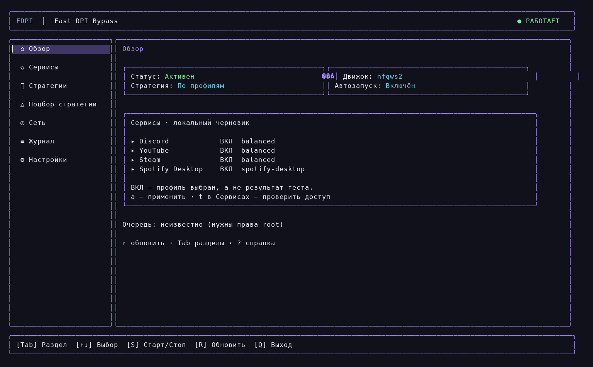
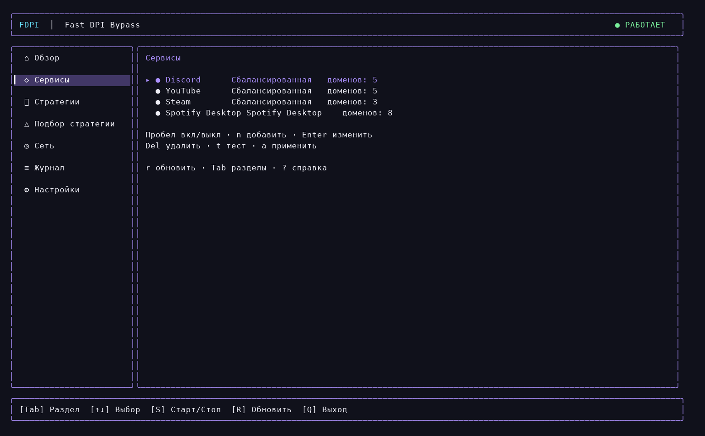
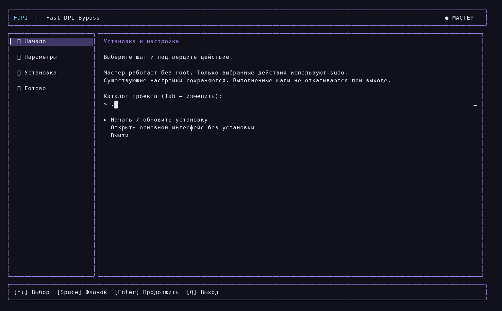
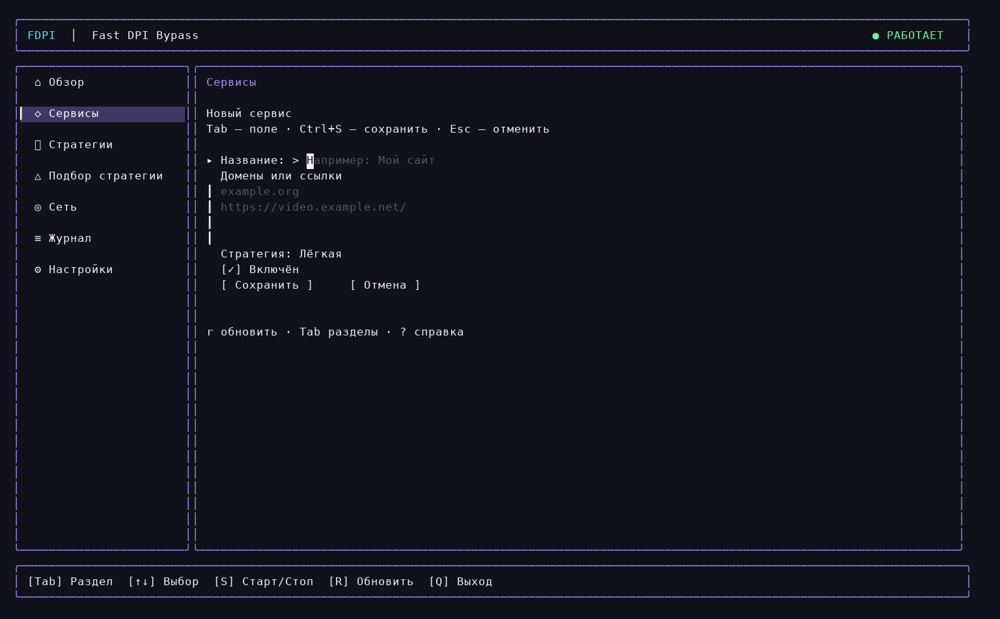

<div align="center">

[](docs/INSTALL_RU.md)
[](go.mod)
[](LICENSE)
[](https://github.com/futureUnd1ground/fdpi/actions/workflows/ci.yml)

**Свой интерфейс. Свои профили. Внешний nfqws2.**

[Установка](docs/INSTALL_RU.md) · [Что такое DPI](docs/DPI_RU.md) · [Архитектура](docs/ENGINE.md) · [Проверки](docs/VALIDATION.md) · [Релизы](https://github.com/futureUnd1ground/fdpi/releases)

</div>

```text
╭─ FDPI ───────────────────────────────────────────────╮
│  Клавиатура → Профиль → Стратегия → Проверка → Старт  │
╰─────────────────────────────────────────────────────╯
```

FDPI — терминальная утилита для Linux и Windows с русским интерфейсом,
интерактивной установкой и отдельной фоновой службой. Локальные изменения применяются явно.
В интерфейсе нет выдуманных PASS: выбранный профиль и проверенный доступ —
разные состояния.

## Обзор



<table>
<tr><td width="50%"><br><b>Сервисы</b> — стрелки, пробел, свои домены.</td><td width="50%"><br><b>Установка</b> — действия по шагам и вывод ошибок.</td></tr>
<tr><td colspan="2"><br><b>Редактор</b> — название, ссылки, стратегия и включение.</td></tr>
</table>

Изображения интерфейса сняты с работающего TUI в PTY и отрисованы из терминальных
ячеек; на Windows отрисовка та же.

## Что такое DPI и зачем нужен FDPI

DPI анализирует пакеты и состояние соединений, чтобы определить протокол
или применить сетевую политику. При HTTPS содержимое защищает TLS, но
параметры соединения и обычно имя сервера в начальном обмене могут быть видны.

Стратегии FDPI меняют форму начального обмена: разделяют TCP-данные,
меняют порядок их отправки или добавляют ложные пакеты. Эффект зависит от
того, как конкретный анализатор собирает и интерпретирует поток.
Универсального набора параметров для всех сетей нет.

**FDPI не является VPN:** он не переносит выход в другую страну и не снимает
ограничения аккаунта. Блокировка IP, ошибки DNS, маршрутизации и MTU требуют
отдельной диагностики. Работа HTTP/TLS также не подтверждает работу QUIC
или воспроизведение видео.

[Подробно о DPI, TLS, QUIC, стратегиях и проверке результата →](docs/DPI_RU.md)

## Установка

### Linux (CachyOS / Arch)

```bash
git clone https://github.com/futureUnd1ground/fdpi.git
cd fdpi
make build
./build/fdpi setup
```

Нужен Go ≥ 1.24. На CachyOS/Arch мастер предложит недостающие зависимости,
соберёт закреплённый nfqws2 и установит единую команду `fdpi`.
Существующий `zlib-ng-compat` заменять не требуется.

```bash
fdpi                         # интерфейс / первый запуск
fdpi setup                   # отдельный мастер
fdpi tui                     # сразу интерфейс
fdpi test-service youtube    # HTML, JPEG и JSON API
fdpi config enable spotify on
fdpi apply                   # применить выбранные профили
```

Conntrack, автозапуск systemd, обновление и PKGBUILD —
[полная Linux-инструкция](docs/INSTALL_RU.md).

### Windows 10/11 (x64)

Сборка не нужна: скачайте `fdpi-windows-amd64.zip` из
[релизов](https://github.com/futureUnd1ground/fdpi/releases) и распакуйте в
отдельную папку, например `C:\FDPI`. Внутри — `fdpi.exe`, `winws2.exe`,
подписанный драйвер WinDivert 2.2.2, Lua-библиотеки и конфигурация по умолчанию.

```powershell
Expand-Archive fdpi-windows-amd64.zip -DestinationPath C:\FDPI
cd C:\FDPI
.\fdpi.exe
```

`fdpi.exe` открывает мастер первого запуска: проверка компонентов, выбор
сервисов (YouTube, Discord, Steam, Spotify) и стратегии, затем установка
службы Windows с автозапуском — один запрос UAC — и тест выбранных доменов.
Движок — Windows-вариант nfqws2 (zapret2) поверх WinDivert; интерфейс тот же.
[Требования, управление службой, пути и удаление →](README_WINDOWS.md)

Клавиши TUI одинаковые на обеих платформах:

| Клавиши | Действие |
|---|---|
| `Tab`, `←`, `→` | Разделы |
| `↑`, `↓`, `j`, `k` | Выбор |
| `Space` | Включение профиля |
| `Enter`, `n`, `Ctrl+S` | Редактировать, добавить, сохранить |
| `s`, `r`, `a` | Старт/стоп, обновить, применить |
| `t`, `d`, `l` | Проверка, диагностика, журнал |
| `?`, `Esc`, `q` | Помощь, назад, выход |

## Что уже проверено

- Полные HTTP/HTTPS-ответы по IPv4/IPv6 в изолированных Linux namespace.
- Настоящая TCP-сегментация, fail-open и очистка только своей таблицы.
- Выбор интерфейса при конкурирующем маршруте VPN/PBR с MTU 1376.
- Прямые HTML, JPEG и API YouTube; диапазон 1 МиБ AV1-видео со стратегией balanced.
- Go vet, unit tests, race detector и dry-run настоящего nfqws2.

Это результаты конкретной сети, а не обещание универсального обхода.
Spotify Desktop использует отдельный профиль HTTP/TLS; воспроизведение,
нативный AP-протокол, регион и ограничения аккаунта отдельно не гарантируются.
Подробности и границы доказательств — в [отчёте](docs/VALIDATION.md).

## Устройство

```text
╭─ FDPI / Go ───────────╮     ╭─ nfqws2 / upstream ─────────╮
│ TUI · CLI · профили   │ ──▶ │ распознавание TCP/TLS/QUIC │
│ диагностика · systemd │     │ стандартные Lua-функции   │
╰──────────────────────╯     ╰───────────────────────────╯
              │                           │
              ╰──── nftables · NFQUEUE ────╯
```

FDPI содержит собственный Go-код управления и компиляции профилей.
[nfqws2 и стандартные Lua-библиотеки](https://github.com/bol-van/zapret2) —
явные внешние зависимости MIT, собираемые без изменения из закреплённого commit.
Их исходники не скопированы в Go-пакеты FDPI. Лицензия upstream устанавливается
вместе с движком.

## Разработка

```bash
make engine
make check
make netns  # user/network namespace, настоящий движок
```

[Участие](CONTRIBUTING.md) · [Безопасность](SECURITY.md) · [История изменений](CHANGELOG.md)

<details>
<summary>Полный справочник CLI, настройки и ограничения</summary>


# FDPI — Fast DPI Bypass

**Первый запуск:** выполните `fdpi setup` (интерактивный мастер), нажмите `i` в TUI или откройте
[установку по шагам](docs/INSTALL_RU.md); для Windows — [отдельную инструкцию](README_WINDOWS.md).
Интерфейс и основные сообщения — на русском.


FDPI 0.4.0 — утилита на Go: на Linux она управляет **настоящим nfqws2**
(NFQUEUE/nftables, systemd), на Windows 10/11 x64 — **winws2** из zapret2
(WinDivert, служба). Основная платформа — CachyOS/Arch Linux. Обработка пакетов
выполняется внешним движком, а не Go. Это первая реализация, ещё не
подтверждённая для ежедневной работы на разных провайдерах.

**Проверено:** сборка, race detector, реальный nftables/NFQUEUE/nfqws2 на ядре
CachyOS в изолированных namespace, передача HTTP/HTTPS payload по IPv4/IPv6,
реальная TCP-сегментация, fail-open и аварийная очистка. Установка с root и прямые запросы HTML/API YouTube, а также 1 МиБ
видеопотока проверены на этой машине с balanced. Полное воспроизведение
в браузере, QUIC и systemd после перезагрузки не проверялись. Подробности: [docs/VALIDATION.md](docs/VALIDATION.md).

## Возможности

- Восемь структурированных стратегий: Light, Balanced, Aggressive, TCP Split,
  TLS Focus, QUIC Focus, TTL Fake, HTTP Host. Копирование и редактирование.
- По умолчанию доменные профили YouTube, Steam и Discord; остальные сервисы
  добавляются через форму с названием и доменами.
  По умолчанию **все выключены**. Списки — стартовые, не исчерпывающие.
- Только собственная таблица `inet fdpi`; атомарный nft batch после `--check`.
- NFQUEUE 24000 с `bypass`, исключение mark `0x20000000`, IPv4 и IPv6.
- Супервизор, ожидание готовности движка, блокировка двойного запуска,
  SIGTERM/SIGKILL, systemd ExecStopPost, последний предыдущий конфиг и rollback.
- Семь экранов Bubble Tea: Dashboard, Services, Strategies, Strategy Lab,
  Network, Logs, Settings. Форма сервисов без JSON; расширенный редактор стратегий сохраняет JSON.
- Темы Auto, Catppuccin Mocha/Latte, Tokyo Night, Gruvbox, Nord, Monochrome,
  Terminal; импорт JSON-палитр wallust/pywal/matugen и коррекция контраста.
- DNS → TCP → TLS с проверкой сертификата → HTTP; фактические измерения.
- Strategy Lab: baseline + пять TCP-стратегий, не больше двух доменов сервиса,
  ограниченные таймауты, паузы, восстановление исходной конфигурации.
- JSON status, journalctl с поиском/уровнями, экспорт диагностики и конфигурации.

## Архитектура и права

```text
cmd/fdpi             команды и точка входа
internal/config      строгая схема JSON, домены, allowlist параметров
internal/engine      аргументы nfqws2, реальные --help и --dry-run
internal/network     nftables: ownership, check, atomic apply, cleanup
internal/service     супервизор, flock, импорт, rollback, systemd
internal/diagnostics поэтапная проверка HTTPS, doctor, Strategy Lab
internal/tui         интерфейс и палитры
packaging            systemd unit, локальный PKGBUILD
scripts              сборка движка, установка, удаление, namespace-тесты
```

Обычный `fdpi` не запускается от root. TUI хранит **локальный черновик** в
`~/.config/fdpi/config.json`. Применение вызывает через sudo установленный
`/usr/bin/fdpi admin apply PATH`; привилегированный код повторно проверяет
JSON, ограничивает размер 4 MiB, создаёт hostlists и делает реальный dry-run.
Произвольные аргументы, engine path и shell-команды в пресетах запрещены.
Системная конфигурация `/etc/fdpi/config.json` и движок
`/usr/lib/fdpi/nfqws2` должны принадлежать root; symlink и запись для группы/
остальных по всей цепочке пути отвергаются. Не добавляйте широкие NOPASSWD
правила sudo для `fdpi`: управление службой остаётся административной операцией.

Сервис использует root UID с ограниченным CapabilityBoundingSet, изоляцией
файловой системы и NoNewPrivileges. nfqws2 получает фиксированный `--uid=0:0`
для доступа к закрытым hostlists; сам upstream оставляет сетевые capabilities
и применяет seccomp. Это **не** непривилегированный packet engine. Сетевой
супервизор не читает пользовательские настройки напрямую. Публичного root RPC
и пользовательского сокета управления нет.

## Сборка и установка на CachyOS / Arch

Go ≥ 1.24, systemd, nftables; для сборки nfqws2 — C toolchain и netfilter libs и Lua.
`libnetfilter_queue` проверен в [официальном Arch Extra](https://archlinux.org/packages/extra/x86_64/libnetfilter_queue/).
Не требуется AUR-пакет с выдуманным названием. Python не нужен.
Существующий `zlib-ng-compat` в CachyOS удовлетворяет зависимости zlib.
Мастер проверяет провайдеры через `pacman -T` и не предлагает заменять его на zlib.

```bash
sudo pacman -S --needed base-devel go git pkgconf nftables libnetfilter_queue libnfnetlink libmnl lua sudo
make check
make build
make engine        # git fetch закреплённого commit; локальная C-сборка
sudo make install # ничего автоматически не запускает
```

Инсталлятор сохраняет существующий системный конфиг и не трогает firewall.
Не используйте `sudo fdpi` для интерфейса.

nfqws2 закреплён на `9b9b929f837978173d787a5773a47a91d90f7f81`.
FDPI самостоятельно компилирует ограниченную модель профилей в вызовы Lua API.
Пакетный движок и стандартные Lua-библиотеки — внешние зависимости zapret2,
собираются без изменения и распространяются со своей лицензией.
См. [ENGINE.md](docs/ENGINE.md).

### Проверка главной YouTube

```bash
fdpi test-service youtube
fdpi test-service youtube --interface enp2s0 --json
```

`fdpi lab youtube` использует те же проверки при сравнении стратегий.

Три независимые проверки: HTML с версией клиента, настоящий JPEG и POST к
API анонимной главной с проверкой JSON. Вывод содержит локальный адрес каждого
соединения: адрес VPN нельзя считать прямым доступом. `--interface` привязывает
TCP к интерфейсу, но не меняет DNS, маршруты и firewall. Kill switch Amnezia
может блокировать прямые соединения. Эта команда не подтверждает видео,
QUIC или работу персональной ленты. Для просмотра результата нужна перезагрузка
страницы в браузере; действующие соединения не используют новую стратегию.

### Conntrack accounting

Для ограничения очереди первыми пакетами соединения требуется accounting.
Проверьте:

```bash
sysctl net.netfilter.nf_conntrack_acct
```

Если значение `0`, осознанно включите:

```bash
sudo sysctl -w net.netfilter.nf_conntrack_acct=1
```

Для сохранения после перезагрузки добавьте
`net.netfilter.nf_conntrack_acct=1` в собственный файл `/etc/sysctl.d/70-fdpi.conf`.
Служба FDPI сама глобальный sysctl не меняет. Мастер `fdpi setup` может включить
этот параметр после подтверждения; persistence предлагается отдельно. Accounting нужен новым соединениям;
существующие соединения могут не иметь счётчиков. Изменение имеет небольшую
цену памяти conntrack. При выключенном accounting FDPI отказывается применять
очередь, вместо молчаливого нерабочего режима.

### PKGBUILD

Пакет локальный, публичного релиза FDPI ещё нет:

```bash
make dist
cp build/fdpi-0.4.0.tar.gz packaging/arch/
cd packaging/arch
makepkg -si
```

В PKGBUILD локальный архив помечен SKIP; для распространения замените его
на фактический SHA256 архива. Исходники zapret закреплены git commit.
Go-зависимости проверяются через go.sum. В сборке нужен интернет для загрузки
исходников и модулей. Пакетирование через makepkg в этой сессии не проверено.

## Первый запуск

```bash
fdpi config init
fdpi config enable youtube on
fdpi config strategy youtube light
fdpi apply                 # sudo; импорт и dry-run, перезапуск только если уже active
fdpi start
fdpi status --json
fdpi test youtube.com
fdpi                       # TUI можно закрыть: сервис продолжит работать
fdpi enable                # автозапуск после reboot
```

`config init` не перезаписывает существующий черновик. Команды работы с
черновиком также создают начальный файл, если его ещё нет.
`fdpi stop` удаляет только собственную таблицу. `fdpi disable` выключает
автозапуск, но не останавливает текущую службу; при необходимости выполните stop.

## TUI и управление

| Клавиша | Действие |
|---|---|
| Tab, ←/→ | Разделы; Shift+Tab назад |
| j/k, ↑/↓ | Выбор / прокрутка деталей |
| Enter | Детали; тема; запуск Lab с подтверждением |
| Space | Включить профиль в локальном черновике |
| n / Enter / Del | Новый сервис / изменить сервис / удалить из черновика |
| e | Форма сервиса; для стратегий — расширенный JSON |
| Ctrl+S / Esc | Сохранить форму / отменить |
| c | Создать копию выбранной стратегии |
| a | Применить локальный черновик через sudo |
| b | Откатить системный конфиг через sudo |
| s | Start/Stop с подтверждением |
| i | Интерактивный мастер установки |
| t | Реальная HTTPS-проверка первого домена Services |
| d | Doctor; можно вызвать из любого раздела |
| l | Загрузить последние записи journal в Logs |
| / | Поиск по списку или открытым логам; Enter завершает ввод |
| r | Обновить статус и перечитать палитру |
| ? / q | Справка / выход |

Интерфейс не опрашивает сеть постоянно, статус обновляется при входе и по `r`.
В форме используйте точные поля схемы из `fdpi config show`. Неизвестные поля
полной конфигурации не принимаются. Сохранение не применяет настройки к сети.
Подтверждённые административные действия временно возвращают терминал sudo/CLI.
Lab показывает полученный JSON в панели деталей; для JSON-файла используйте `fdpi lab youtube --json > youtube-lab.json`.
Минимум 28×10; проверена отрисовка 40×15, 80×25, 120×40 и отказ при 20×8.
Kitty/Alacritty/foot используют стандартные ANSI/termios, но отдельно не запускались.

Подробнее об экспорте палитр: [THEMES.md](docs/THEMES.md).

## Стратегии, hostlists, импорт и экспорт

```bash
fdpi strategies
fdpi profiles
fdpi config show
fdpi config export preset.json
fdpi config import preset.json
fdpi config validate
fdpi apply
fdpi rollback
sudo fdpi config system     # фактически импортированный системный конфиг
```

В разделе «Сервисы» нажмите `n`, введите название и домены или ссылки.
`Enter/e` открывает форму существующего сервиса, `Del` удаляет его из черновика.
Стратегия выбирается стрелками ←/→, флажок — пробелом; `Ctrl+S` сохраняет.
Только ASCII-домены нижнего регистра без схемы/пути; IDN вводятся как punycode.
Поддомены сопоставляет upstream nfqws2. Конфликтующие пересечения **разных**
включённых сервисов отклоняются, чтобы порядок профилей не скрывал настройки.

`tcp`: пусто, multisplit, multidisorder, fake, fake,multisplit,
fake,multidisorder, fakedsplit, fakeddisorder. `split`: числовые позиции и
документированные маркеры method/host/endhost/sld/endsld/midsld/sniext.
`fooling`: badseq, md5sig, badsum, ts; TTL 0..255, repeats 1..10.
`quic` включает fake для UDP/443 с l7=quic, `host_case` — HTTP Host case.
Точные ограничения конкретного движка дополнительно проверяет `--dry-run`.

Техники и риски:

- Light/TCP Split/TLS Focus сегментируют TCP, включая байты ClientHello/SNI.
  **TLS record fragmentation не реализована**: TCP segmentation — другой механизм.
- Fake/TTL/MD5/badseq зависят от DPI, ОС сервера и маршрута. TTL 3 не универсален.
- HTTP Host не меняет зашифрованный HTTPS. QUIC Focus не является туннелем Discord
  voice, Telegram MTProto или игрового UDP; обработка ограничена QUIC UDP/443.
- Доменные списки не означают фильтрацию процессов; ECH, прямые IP, нестандартные
  порты и скрытый SNI могут не сопоставляться. Cgroups/ipsets не реализованы.

Таблица отправляет в очередь только первые 20 исходящих TCP-пакетов 80/443 и
первые 12 UDP-пакетов 443, когда соответствующие стратегии включены. Проверка
домена выполняется **в nfqws2**, поэтому начальные пакеты других сайтов на этих
портах тоже проходят очередь. После профилей добавляется catch-all без действий.
Другие протоколы/порты, loopback и собственные fake mark не ставятся в очередь.
Трафик роутера/forwarding не поддержан: обрабатывается локальный output.

## Strategy Lab

```bash
fdpi lab youtube --json > youtube-lab.json
```

Нужна установленная systemd-служба и root через sudo. Используется **системный**
конфиг. Lab берёт operation lock, сохраняет исходное состояние, временно отключает
целевой профиль для baseline, затем проверяет Light, Balanced, TCP Split,
TLS Focus, Aggressive. Остальные профили сохраняются. В конце возвращает конфиг
и исходное состояние службы даже после SIGINT/ошибки. Существующие TCP-соединения
не сбрасываются, но обработка новых handshake при перезапуске может отличаться.

Результат: отдельные ошибки DNS/TCP/TLS/HTTP, HTTP-код, адреса, время и timestamp.
HTTP 200 не единственный результат: TLS-проверенный HTTP-ответ означает
транспортную достижимость; 403/451 и другие ошибки приложения видны отдельно.
Для рекомендации требуется, чтобы baseline не достиг всех целей с HTTP <400,
а кандидат достиг. Самая быстрая из единичных проб — лишь подсказка: это не
статистически устойчивый benchmark и не доказательство обхода DPI. Если baseline
уже успешен, рекомендация не формируется. Применение — отдельно после просмотра.
QUIC, видео, звонки, авторизация, приложения и CDN content этим тестом не проверяются.

Одновременно другой Lab/apply запрещён flock. Start/Stop/Restart через FDPI берут ту же блокировку. Прямой systemctl вне FDPI
обходит эту защиту; не запускайте его параллельно Lab. SIGKILL и выключение питания
не позволяют выполнить defer: после них проверьте конфигурацию и используйте
rollback. Это ограничение описано явно; пока нет журнала восстановления Lab.

## Диагностика и логи

```bash
fdpi doctor
sudo fdpi doctor
fdpi doctor --export diagnostic.json
fdpi logs
fdpi logs --follow
fdpi logs --grep 'error|failed' --category warning
journalctl -u fdpi.service -b
```

Doctor не меняет сеть: проверяет движок, dry-run, конфиг, nft, владение таблицей,
NFQUEUE, accounting, capabilities, DNS и systemd. Наличие queue/flowtable в
ruleset отмечается как возможный конфликт, включая собственную очередь FDPI.
Это эвристика: firewalld, flow offload, другие zapret и nft hook priorities
нуждаются в ручной проверке. nft --check также требует сетевых capabilities.
Queue в непривилегированном status может быть `unknown`; JSON явно сообщает
`queue_observable=false`, а не выдаёт недоступное наблюдение за подтверждённое.
Доступ к журналу зависит от групп/journald ACL. Нет packet debug/дампов трафика
в обычном режиме. Диагностические отчёты содержат домены, IP и сведения о системе.
Обычный вывод читается по-русски; `fdpi doctor --json`, `fdpi test ДОМЕН --json`
и `fdpi lab СЕРВИС --json` оставляют структурированный формат для скриптов.
Текстовая инструкция без выполнения команд: `fdpi setup --guide`.
ID стратегий, названия команд, ключи JSON и исходные сообщения ОС/nfqws2 сохраняются.

Если сеть не работает: `fdpi stop`, затем `sudo fdpi cleanup`. Команда никогда
не делает flush ruleset. Чужая таблица с именем fdpi без ownership marker
не удаляется — переименуйте конфликтующую таблицу самостоятельно.

## Проверки и производительность

```bash
make check                # gofmt, vet, test, race
make build
FDPI_TEST_ENGINE="$PWD/build/nfqws2" go test -count=1 -v ./internal/engine
make netns                # user+network namespaces, veth, настоящий nft/nfqws2, HTTP/HTTPS IPv4/IPv6
make bench
```

`netns` требует iproute2, util-linux, newuidmap/newgidmap и настроенные subuid/
subgid для `unshare --map-auto`. Тесты проверяют отдельный namespace и отказываются
работать на основной сети. Accounting включается только в тестовом namespace.
Root sudo для этих тестов не нужен. При недоступных namespaces штатный unit test
их пропускает, а явный `make netns` завершается ошибкой; это не считается успехом.

Бенчмарки: JSON parsing, 10k hostlist validation, nft generation, первый TUI render;
скрипт также измеряет subprocess CLI и TUI до первого кадра в настоящем PTY,
maxRSS через Linux rusage; `/usr/bin/time` используется дополнительно, если установлен.
Это воспроизводимые микротесты, не замер CPU/RAM работающего packet engine под
нагрузкой. Результаты конкретной машины находятся в docs/VALIDATION.md.

## Обновление и удаление

`fdpi update` выводит проверяемую процедуру, не скачивает/исполняет remote code:
обновите свой checkout, выполните проверки, пересоберите и установите. Публичного
release endpoint/автообновления пока нет. При изменении commit движка обязательно
повторите dry-run и namespace-тесты. Установщик не перезапускает активный сервис;
после обновления явно выполните `fdpi restart`.

```bash
sudo make uninstall
# Если установлено через makepkg:
sudo pacman -R fdpi
```

Скрипт остановит службу и удалит собственные правила, бинарники и unit.
`/etc/fdpi` и все пользовательские настройки сохраняются. Для удаления пакета
сначала выполните `fdpi disable` и `fdpi stop`: package-manager не гарантирует
остановку действующего сервиса. Если больше не нужен собственный sysctl-файл,
удалите его самостоятельно; не выключайте accounting, нужный другим программам.

## Лицензии

FDPI — MIT. Zapret/nfqws2 — MIT, copyright bol-van; при установке сохраняется
оригинальный `docs/LICENSE.txt` upstream. Код nfqws2 в репозиторий FDPI не копируется.
Bubble Tea/Lip Gloss/Bubbles и транзитивные Go-зависимости имеют собственные лицензии.
libnetfilter_queue — GPL; используется отдельным динамически связанным upstream
бинарником. При распространении бинарников соблюдайте лицензии и предоставление
соответствующих исходников зависимостей. См. [ENGINE.md](docs/ENGINE.md).

</details>
